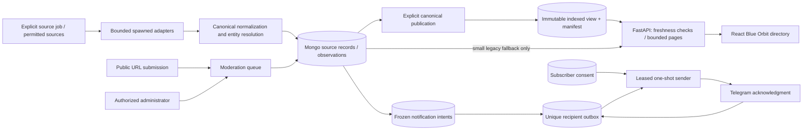

# Architecture

The API does not publish views or run scans. Above 2,000 public raw rows a valid
prepared view is required; source writes/time boundaries invalidate it. Search
streams candidates; geographic sorting can scan/spill in Mongo. Publication is an
offline O(N) operation. Provenance/IDs survive canonical read coalescing.

Notification claims and receipts are atomic per row, not a transaction with Telegram.
Consent is checked again before sending. Interrupted fan-out/leases recover; uncertain
external acknowledgments can duplicate messages. Deadline-change enqueue is still a
separate commit from source ingestion. See the phase reports for exact contracts.
